# Tread Horizon · 脚步丈量世界

把去过的地方、看过的风景、拍下的照片和视频，钉在地图上。多年以后打开，就是一张**只属于你自己的旅行足迹地图**。

- **纯本地运行**：数据存在自己电脑里，不需要账号，也不会上传云端
- **地图用天地图**：需要自己申请一个免费 Key，申请一次、填进去就能用
<p align="center">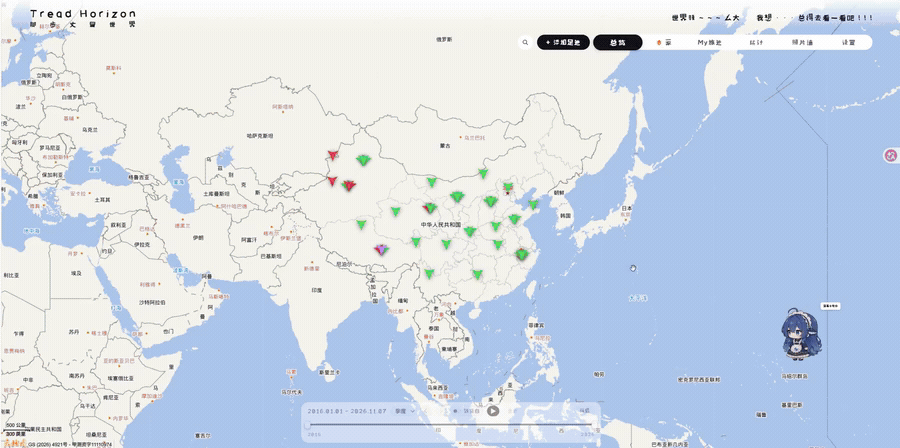</p>


> 仓库地址：<https://github.com/BruceLi007/TreadHorizon> · 许可：[MIT](LICENSE)

---

## 能做什么

### 在地图上打点，记录足迹

- **搜索打点**：搜地名 → 地图飞过去 → 落下足迹；也可以直接在地图上点选位置，拖动飞镖微调

<p align="center">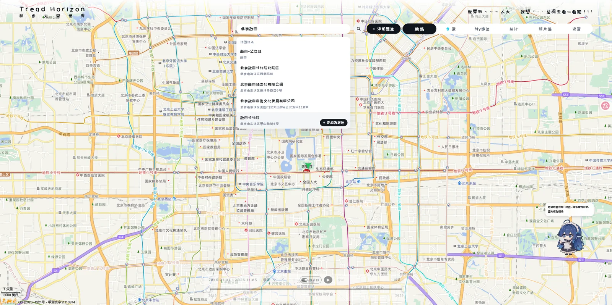</p>


- **四种标记**：去过（绿）、想去（红）、家（小房子）、秘密基地（紫，打开详情需要密码）；**标记会动**：静置时轻轻呼吸，悬停会轻跳，点击时压扁回弹并在地面荡开一圈涟漪；**自动聚合**：地点多的时候，地图上会按类型抱成一簇，点一下展开该区域的地点列表

<p align="center">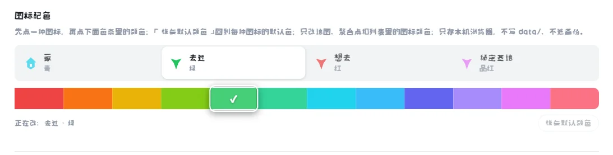</p>


<p align="center">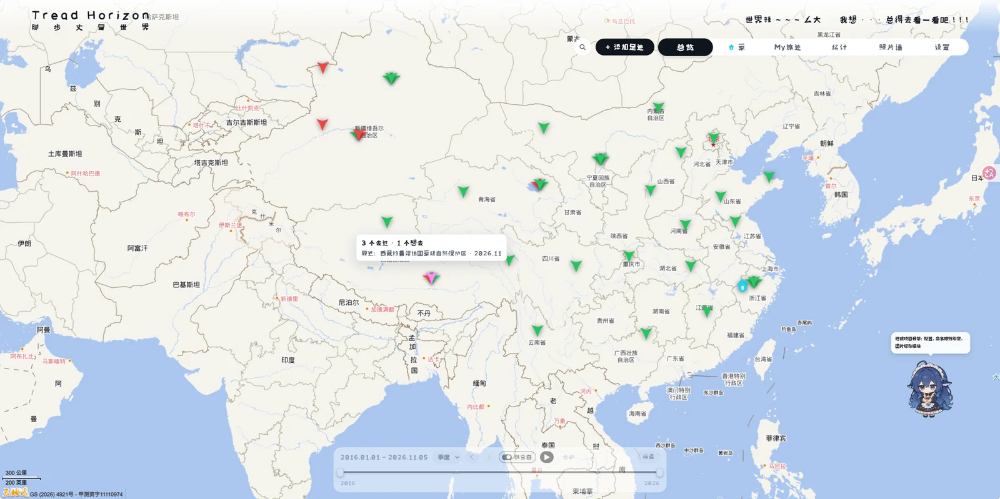</p>


<p align="center">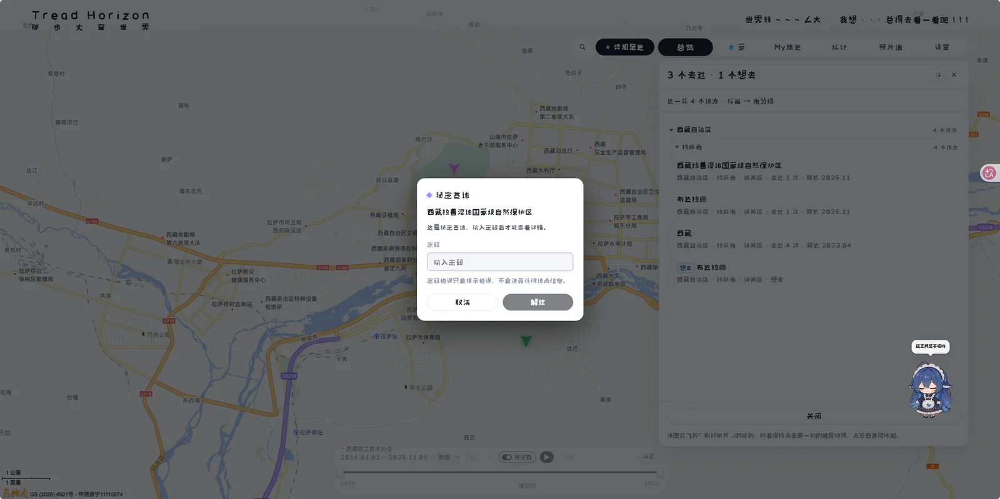</p>


- **家**：地图上唯一一个「家」标记，不参与聚合，点顶栏「家」一键飞回去

<p align="center">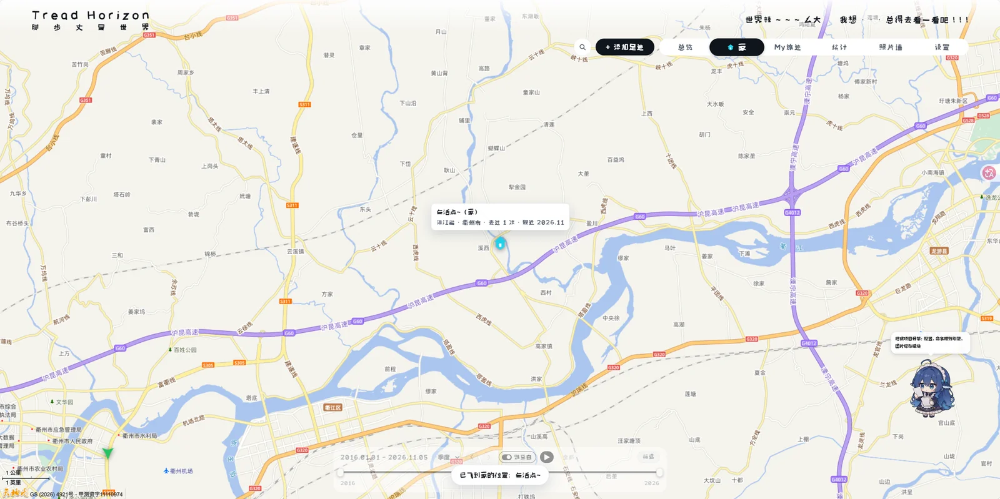</p>


- **不会点歪**：地图缩得太远时不允许打点；暂不支持记录国外坐标

### 照片和视频，一次传好

- **记录结构**：地点 → 到访（日期 / 标题 / 笔记 / 评分 / 同行人）→ 照片、视频；**上传省心**：拖进侧栏或点选即可，支持批量；每个文件显示进度，可取消，失败能重试；**自动查重**：同一张图再传一次会跳过，不重复占空间；**视频也有封面**：自动截取封面帧并显示时长（装好 ffmpeg 才有；没装视频照样能播放）
<p align="center">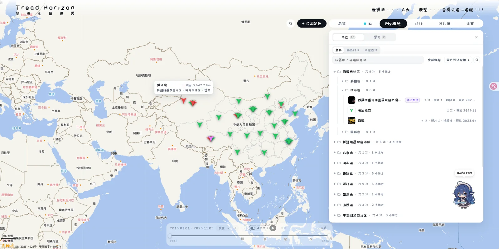</p>

- **归档整齐**：上传时复制一份到素材库，按「省 / 市 / 区县 / 日期_地点名」自动分好文件夹；电脑里的原片不会被移动

### 看照片的体验

- **相册网格**：地点侧栏的照片每行可切换 2 / 3 / 4 / 5 张
- **灯箱**：左右翻页、缩放，底部有一条缩略图胶片带——点一下就切，翻页时会自动滚到当前那张
- **照片墙**：全屏按年份浏览、无限滚动、年份快捷筛选，每行可切 4 / 6 / 8 / 10 张
- **双向跳转**：照片墙里点「在地图中查看」直接飞到对应地点；地点灯箱里也能跳回照片墙定位
- **可调大小**：照片墙窗口右下角可以拖动缩放，会记住上次的大小
<p align="center">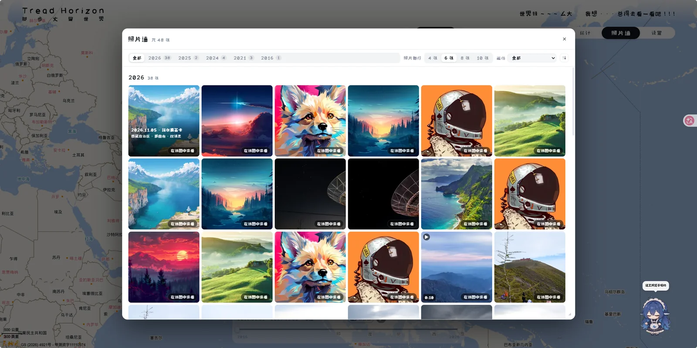</p>

<p align="center">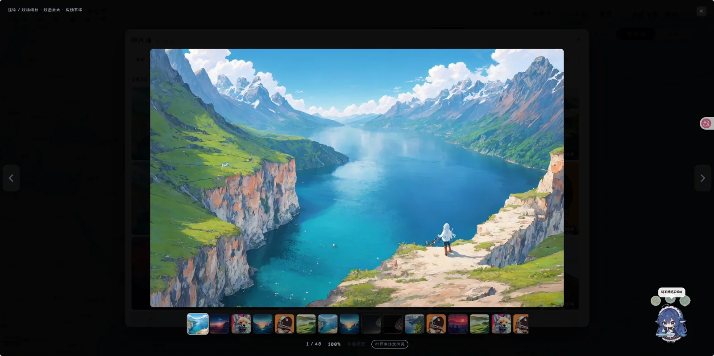</p>


### My旅迹：所有去过 / 想去的地方

- **树形整理**：「去过」按 省 → 市 → 地点 分组，地点行显示次数、照片数、视频数、最近到访时间
- **想去清单**：想以后去的地方单独一份，可以随时「转为去过」
- **一键展开 / 收起**、按最近 / 最早到访排序、按名称或省市搜索；**和时间轴联动**：框选一段时间后，My旅迹会显示「这段时间去过几次 · 共几次」
<p align="center">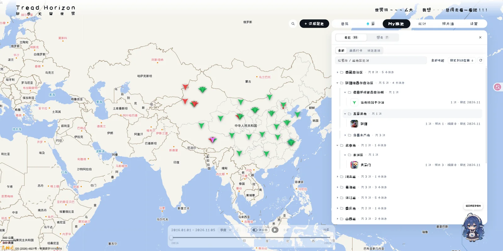</p>

<p align="center">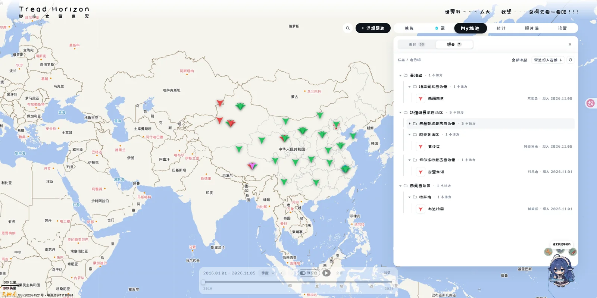</p>


### 时间轴：看「什么时候去过哪」

- **双手柄框选**：拖动底部时间轴的两个手柄，地图、清单、统计一起跟着变
- **自动回放**：按 天 / 周 / 月 / 季度 / 年 步长播放足迹动画；也可以 `‹` `›` 手动步进
- **跳过空白**：可只走有记录的时间段；一个按钮回到「全部」
<p align="center">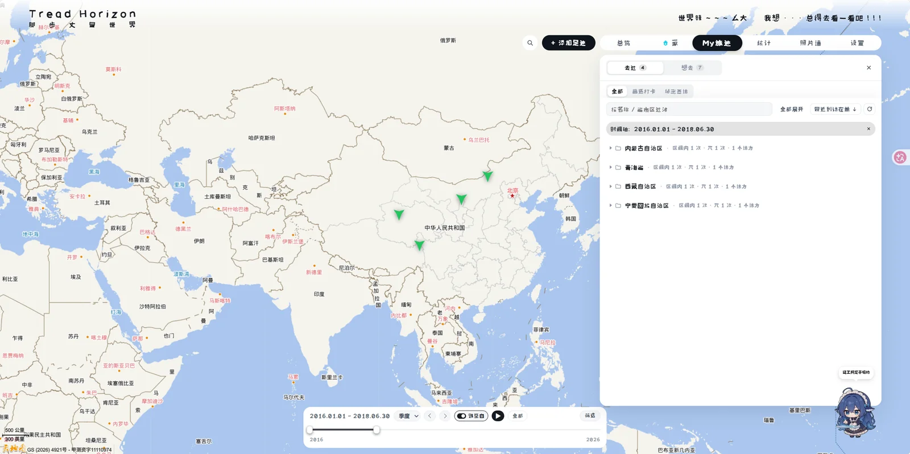</p>

<p align="center">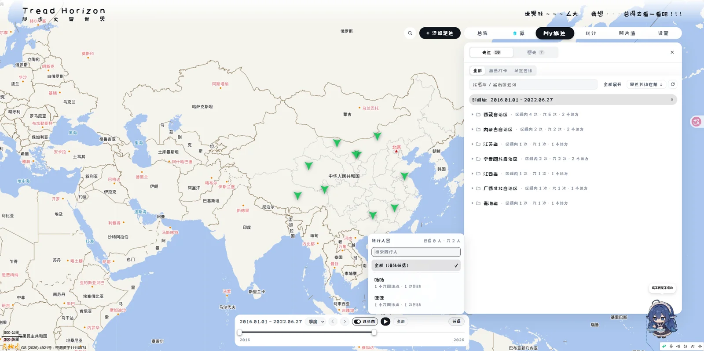</p>


### 统计：回顾你的旅行

- **省份点亮**：去过的省份在地图上按到访次数分 4 档点亮（橙色），一眼看出走过哪片山河
<p align="center">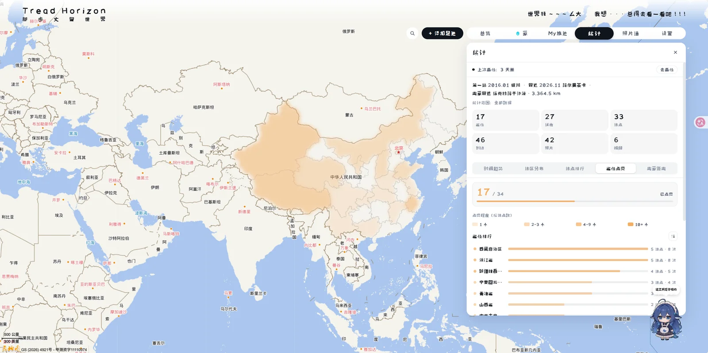</p>

- **总览数字**：省份 / 城市 / 地点 / 到访 / 照片 / 视频 六个数字
- **时间趋势**：按年 / 季 / 月看访问走势
- **地区分布**和**地点排行**：哪个省去得最多、哪些地方反复去
<p align="center">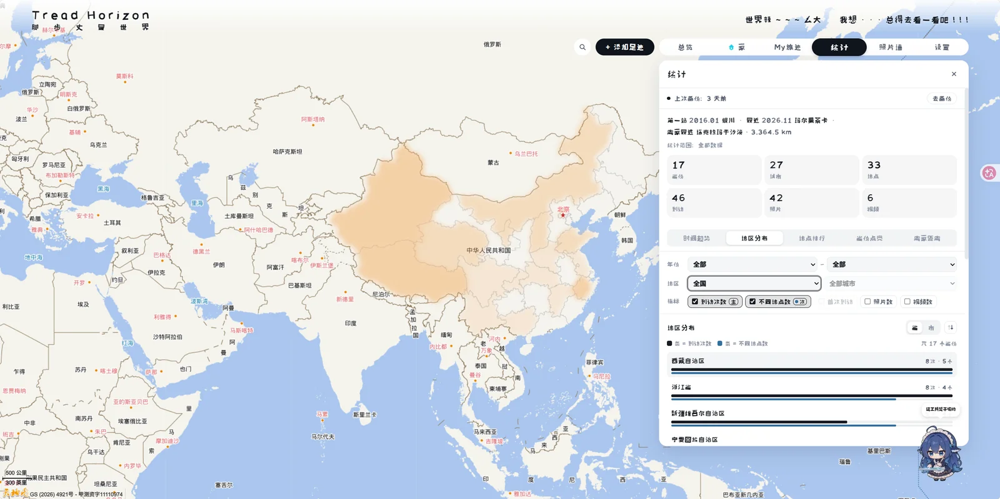</p>

- **离家距离**：离家最远的地点，以及按距离排序的「离家距离」榜
<p align="center">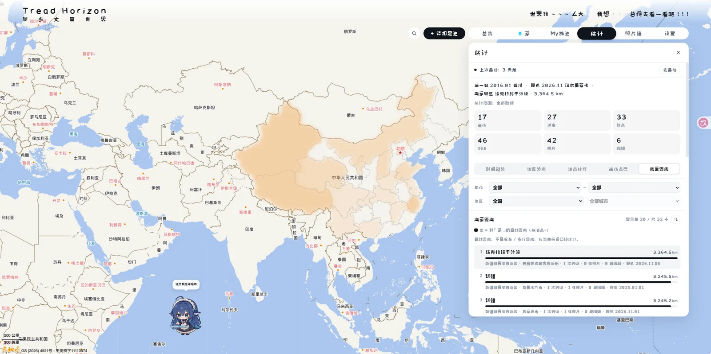</p>


### 用着顺手

- **中英文**：设置里一键切换，立即生效
- **字体**：6 档界面字体（2 款随仓库附带的 SIL OFL 字体 + 4 款系统字体）、字号 3 档、字重 2 档
- **外观**：纯白 / 浅色 / 深色 / 纯黑 4 档明暗，也可以跟随系统
- **主题标语**：顶栏那句标语可以自己改
- **图标配色**：家 / 去过 / 想去 / 秘密基地 四种地图图标都能换颜色
<p align="center">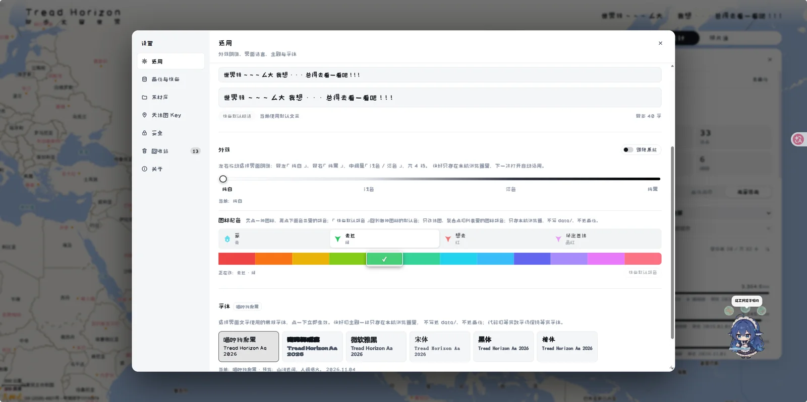</p>


### 整理与清理

- **回收站**：删除先进回收站，误删可恢复；确认不要了再「彻底删除」，才会真正释放素材空间
- **合并重复地点**：不小心把同一个地方记成两个？选两条合并即可
- **素材管理**：移动、删除、设为封面、一键打开素材所在文件夹

### 备份与迁移

- **导出备份**：元数据必选，缩略图 / 照片视频可选；后台打包，有进度，可取消；大包不占页面内存
- **从备份恢复**：先「检查备份包」看摘要 → 二次确认 → 自动把当前数据备份一份 → 再恢复；含素材会做内容校验
- **备份提醒**：可设 7 / 14 / 30 / 60 / 90 天提醒
- **换电脑**：拷走 `data/` + 素材库 + `.env.local` 即可

###

---

## 快速开始

### 环境要求

- **Node.js ≥ 22.5**（推荐 24 LTS）和 npm
- **ffmpeg**：可选。装了视频会有封面帧和时长，没装也能正常上传 / 播放
- **天地图 Key**：免费，浏览器端类型。申请地址 <https://www.tianditu.gov.cn/>；仓库里有作者的《天地图 Key 申请教程》PDF：[`public/docs/tianditu-key-guide.pdf`](public/docs/tianditu-key-guide.pdf)

### 三步跑起来（日常使用）

```bash
npm install
npm start          # 构建并启动；浏览器打开 http://127.0.0.1:4000
```

首次打开会先出现「配置天地图 Key」引导页，粘贴 32 位 Key 即可进入应用（之后可以在 **设置 → 天地图 Key** 修改）。想提前写进配置文件的话：

```bash
cp .env.example .env.local
# 然后在 .env.local 里把 TDT_TK= 后面填上你的 32 位 Key
```

> **端口**：默认 **4000**，可用 `PORT` 修改（例如 `PORT=4001 npm start`）；服务只监听 `127.0.0.1`，所以只有本机能打开。
> 已经构建过之后，可以用 `npm run serve` 直接启动（不用重复构建）。

### 开发 / 改代码

```bash
npm run dev        # 前端 http://localhost:5173（API 自动跑在 4000，并把 /api 代理过去）
```

### 不想自己装？把下面这段话发给你的 AI 助手

> 把下面这段话发给你的 AI 助手，让它帮你安装好：

```text
帮我安装这个开源项目到本地并跑起来：https://github.com/BruceLi007/TreadHorizon
我的系统是：Windows（macOS 用户改成 macOS）帮我检查下部署环境。
请按仓库 README 的步骤来；注意它要求 Node.js ≥ 22.5（推荐 Node 24 LTS）。
装完请给我启动方式！
```

---

## 数据放在哪 / 隐私

| 内容                  | 位置                                      |
| ------------------- | --------------------------------------- |
| 数据库、缩略图、自动备份        | `data/`                                 |
| 素材库（上传时复制一份原片，原片不动） | 默认 `.dev-media/`，可在设置里或 `MEDIA_ROOT` 修改 |
| 导出的备份 zip           | `data/backups/` 或浏览器下载                  |

- 第一次启动会自动创建 `data/`、`data/thumbs/` 和素材库目录，不用手动建
- 公开仓库里**不含任何人的真实数据**：每个人第一次打开都是自己的空库
- 所有数据都在你自己的电脑上，不联网也不上传
- 删除 `data/` = 清空应用数据（不可恢复，请先备份）；删除素材库只删应用副本，电脑里的原片不受影响

---

## 常见问题

**地图一片空白 / 加载不出来？**
检查天地图 Key 是否已填写、是否填错；免费 Key 有每日调用次数限制，用完后当天可能加载不出，第二天恢复。如果 Key 在天地图控制台设了域名白名单，记得把访问地址加进去。

**视频没有封面？**
装好 ffmpeg 后重启服务即可；没装也能正常播放视频。

**第一次打开只看到「配置天地图 Key」页面？**
这是正常的：应用需要先填一个免费的天地图 Key 才能加载地图。按页面提示粘贴 32 位 Key 即可进入；也可以提前写进 `.env.local` 的 `TDT_TK`。

**端口 4000 或 5173 被占用？**
换一个端口，例如 `PORT=4001 npm start`；开发模式可用 `npm run dev -- --port 5174`（或关掉占用端口的程序）。

**想换电脑 / 备份数据？**
拷贝 `data/` + 素材库目录 + `.env.local` 到新电脑；或者在「设置 → 备份与恢复」导出 / 恢复。

**想分享自己的足迹给别人看？**
只读分享链接还在计划中，后续版本推出。

**数据会被上传吗？**
不会，所有数据都在你自己的电脑上。

---

## 已知限制 / 路线图

- **国外记录**：暂不支持，打点只在中国及周边范围内
- 个人维护的开源项目，欢迎提 Issue 交流

---

## 技术栈与目录（给开发者）

- 前端：React 19 + Vite 8 + TypeScript
- 后端：Fastify 5 + Node 内置 `node:sqlite` + sharp；视频封面可选 ffmpeg
- 地图：天地图（底图 / 搜索 / 逆地理）
- 运行模式：默认单机本地模式（`AUTH_MODE=local`，数据全部在本机）

```text
server/    后端
src/       前端
public/    静态资源（地图标记、省界数据、2 款 SIL OFL 字体、天地图 Key 教程 PDF）
scripts/   初始化 / 迁移 / 测试脚本
design/    设计预览图与生成脚本
data/      运行期数据（不进 Git）
```

---

## 第三方资源与许可

- **字体**：`public/fonts/` 随仓库附带 2 款 **SIL OFL 1.1** 字体——**喵咛狗爬黑**（默认界面字体）/ **嗷呜碎瘾黑**，版权与 OFL 全文见 [`public/fonts/LICENSES.md`](public/fonts/LICENSES.md)；设置里的微软雅黑 / 宋体 / 黑体 / 楷体由操作系统提供，不随仓库分发
- **地图与地理编码**：天地图官方服务（需自备浏览器端 Key；审图号由天地图瓦片自带）
- **省界数据**：`public/province-boundaries*.json` 由 geojson.cn「天地图-国家标准矢量地图」整理，仅用于省份点亮
- **开源依赖**：React / Vite / Fastify / sharp 等第三方库遵循各自许可（见 `package-lock.json`）
- 其余美术资源（地图标记 SVG、光标、`design/` 下的设计图）为项目自绘 / 自生成；`public/docs/tianditu-key-guide.pdf` 为作者编写的教程

## License

本项目**源代码**（含仓库内 README 等文本）采用 **MIT License**：见 [LICENSE](LICENSE)。

```text
Copyright (c) 2026 李其阳 (GitHub: @BruceLi007)
```

> 第三方资源（字体、地图数据、开源依赖等）不在此 MIT 授权范围内，分别遵循其自身许可（见上方「第三方资源与许可」与 `public/fonts/LICENSES.md`）。
